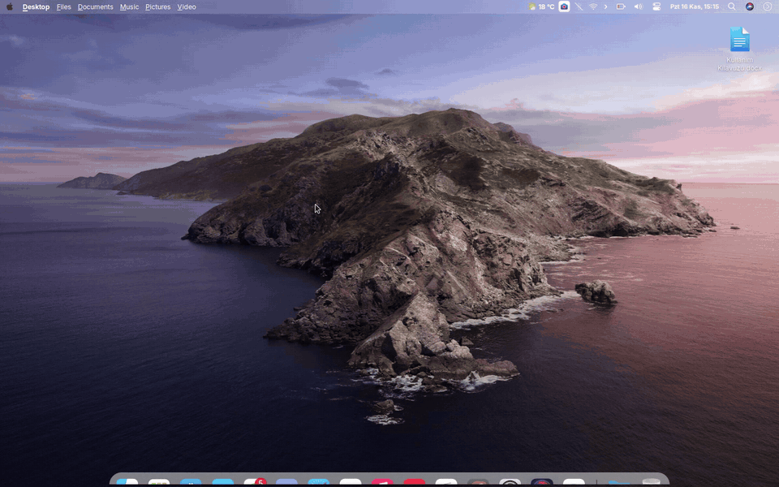
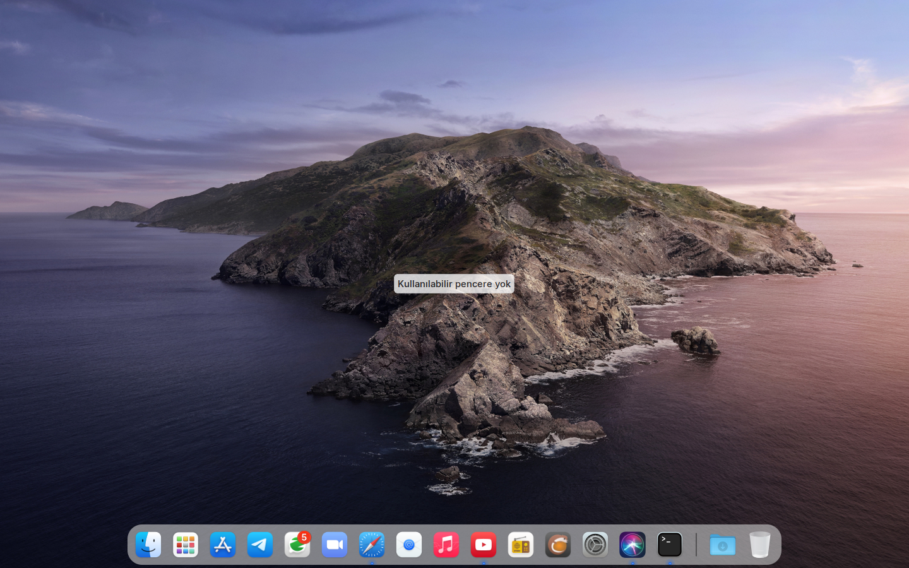

# skippy-mac

A fork of [skippy-xd](https://github.com/felixfung/skippy-xd) by Felix Fung, tuned to feel closer to macOS: an exposé that works together with a real dock, cleaner labels and a few behaviour fixes. Built and used daily on a MacBook Air (mid 2012) running Xubuntu 24.04 with Plank and picom.



Everything that is general enough is sent upstream as a pull request first, and most of it has been merged. This fork carries the rest and follows upstream closely (currently 0.12.2).

The program, its command (`skippy-xd`) and its config (`~/.config/skippy-xd/skippy-xd.rc`) keep their original names, so existing setups and scripts keep working.

## What's different

### Dock stays real and clickable

```
[panel]
passthrough = Plank
```

Panels whose WM_CLASS matches `passthrough` (same syntax as `--wm-class`) are not drawn as a copy. The real dock stays visible and clickable on top of the exposé, like the Dock during Mission Control. Clicking it closes skippy and the click goes to the dock as usual: open an app, raise its windows, and so on. Works best with `pseudoTrans = false`. Use `show = false` to hide the remaining panels, for example the top panel.

The dock sits on skippy's own background: windows behind its transparent parts (Plank's window is much larger than the dock it draws) do not show through, wherever the dock is. An auto-hiding dock keeps its place while hidden.

With xfwm4, set `easy_click` to something other than the key that holds switch open (usually Alt), or xfwm4 takes clicks on the dock during Alt-Tab for moving windows: `xfconf-query -c xfwm4 -p /general/easy_click -s Super` (or `none`).

### Limit the reserved panel space

```
[panel]
maxThickness = 80
```

With `reserveSpace = true`, at most this many pixels are reserved per panel (0 = no limit). Useful when a dock window is much taller than what it draws, as with Plank.

### "No Available Windows"

```
[label]
emptyText = No Available Windows
```



When there is no window to show, this text is shown in the middle of the screen as a label, like macOS. Empty by default (off).

### Closes when something else opens

If a new window, popup menu or utility window opens while skippy is shown (an app launched from the dock, a control center opened by a shortcut, a screenshot tool), skippy closes instead of keeping it hidden behind the exposé.

### Smaller fixes

- skippy's windows are mapped and unmapped in one go, so the compositor does not show them half drawn.
- Every preview is taken away on close, also those of windows that left the list meanwhile.
- Previews of Chromium-based apps keep their size when the window loses focus (`_GTK_FRAME_EXTENTS` is remembered).
- The pager highlights the selected desktop ([#573](https://github.com/felixfung/skippy-xd/pull/573), not merged upstream).

## App Exposé

skippy-xd can show the windows of one app with `--wm-class`. A small script makes it work like App Exposé for the active app:

```sh
#!/bin/sh
win=$(xprop -root _NET_ACTIVE_WINDOW | sed 's/.*# //; s/,.*//')
class=$(xprop -id "$win" WM_CLASS 2>/dev/null | awk -F'"' '{print $4}')
[ -n "$class" ] || exec skippy-xd --expose --wm-class '!*'
exec skippy-xd --expose --wm-class "$class"
```

Bind it to a key or a gesture (for example with Touchégg). With no active app it shows the empty notice.

## Build

```
git clone https://github.com/memecikoliveoil/skippy-mac.git
cd skippy-mac
meson setup build --prefix=/usr/local
meson compile -C build
sudo meson install -C build

skippy-xd --start-daemon
skippy-xd --expose
```

For everything else (other options, key bindings, paging, switch mode) see the [upstream README](https://github.com/felixfung/skippy-xd#readme) and [wiki](https://github.com/felixfung/skippy-xd/wiki).

## Credits

skippy-xd is maintained by [Felix Fung](https://github.com/felixfung), with contributions from many people over the years. Thanks to Felix for the reviews and to Tomas M for his fixes. Licensed under the GPL, like upstream.
